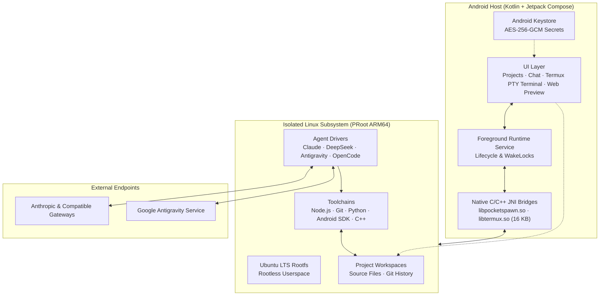

<div align="center">


# Mobile Harness

**The autonomous AI development workspace for Android.**

Chat with coding agents, edit project files, run an interactive Linux PTY terminal, and preview live web servers directly on your phone.

[](https://github.com/techjarves/Mobile-Harness/releases/tag/v1.0.7)
[](#system-requirements)
[](#system-requirements)
[](LICENSE)

[Download Online APK](https://github.com/techjarves/Mobile-Harness/releases/download/v1.0.7/mobile-harness-online-v1.0.7.apk) ·
[Download Offline APK](https://github.com/techjarves/Mobile-Harness/releases/download/v1.0.7/mobile-harness-offline-v1.0.7.apk) ·
[Watch Demo](https://youtu.be/x5T56timmQw) ·
[Quickstart](#quickstart) ·
[Architecture](#architecture) ·
[Build from Source](#developer-guides)

</div>

---

<p align="center">
  <a href="https://youtu.be/x5T56timmQw" target="_blank" rel="noopener noreferrer">
    
  </a>
  <br />
  <sub>Product walkthrough: provisioning Ubuntu, connecting an agent, and building an app on Android</sub>
</p>

> [!IMPORTANT]
> **Environment Security Notice**
> Mobile Harness runs an unprivileged userspace Linux environment via PRoot on ARM64 Android devices. While isolated from other apps by standard Android sandboxing, PRoot is not a kernel-level VM or hardened security jail. Only run repositories and dependencies you trust.

---

## Download

Both editions include the full application and support signed in-app updates:

| Edition                            |     Size     | Best For                                                                                  |                                                            Download                                                             |
| :--------------------------------- | :----------: | :---------------------------------------------------------------------------------------- | :-----------------------------------------------------------------------------------------------------------------------------: |
| **Online Edition** _(Recommended)_ | **89.1 MB**  | Fast initial install; downloads Core, Python, and Android toolchains on demand            |  [Download Online APK](https://github.com/techjarves/Mobile-Harness/releases/download/v1.0.7/mobile-harness-online-v1.0.7.apk)  |
| **Offline Edition**                | **889.4 MB** | Air-gapped or metered setups; bundles Core, Python, and Android toolchains inside the APK | [Download Offline APK](https://github.com/techjarves/Mobile-Harness/releases/download/v1.0.7/mobile-harness-offline-v1.0.7.apk) |

---

## Core Capabilities

- **Autonomous Multi-Agent Coding:** Dedicated, isolated drivers and session persistence for **Claude Code**, **DeepSeek Harness**, **Antigravity CLI**, and **OpenCode**.
- **Embedded Termux PTY Terminal:** Full VT100/truecolor interactive shell powered by Termux `terminal-emulator` and `terminal-view` (`v0.118.3`) over a 16 KB page-aligned native PTY bridge (`libtermux.so`), featuring a sticky 2×7 Extra Keys bar, pinch-to-zoom, customizable cursor/font settings, and read-only mini terminals for live setup and build logs.
- **Rootless Ubuntu LTS Subsystem:** Self-contained ARM64 Ubuntu LTS userspace inside PRoot with Git, OpenSSL, GNU coreutils, and Node.js LTS (lazy-loaded NVM) — no root access or external terminal apps required.
- **On-Device Android APK Builds:** Compile debug APKs directly inside the workspace and pass them straight to Android's package installer without USB or wireless ADB pairing.
- **Instant Web Preview:** Test local Vite, Next.js, or Express servers inside a sandboxed WebView with console output inspection.
- **Native File Workflow & Keystore Security:** Browse, edit, search, import, and export files via Android Storage Access Framework (SAF), with API keys encrypted in hardware-backed Android Keystore (AES-256-GCM).

---

## Interface Overview

<table>
  <tr>
    <th width="33%" align="center">Projects</th>
    <th width="33%" align="center">Terminal</th>
    <th width="33%" align="center">Settings</th>
  </tr>
  <tr>
    <td align="center"></td>
    <td align="center"></td>
    <td align="center"></td>
  </tr>
</table>

---

## Quickstart

1. **Install the APK:** Download either the Online or Offline ARM64 APK from [GitHub Releases](https://github.com/techjarves/Mobile-Harness/releases/latest) and install it on an Android 9+ device.
2. **Complete Guided Setup:** Follow the 3-step onboarding flow to grant background execution permissions, provision the Ubuntu LTS runtime and optional toolchains, and configure your AI provider.
3. **Create a Project & Build:** Tap **New Project** (or **Quick Project**), describe your task in the workspace chat, and use the **Terminal**, **Files**, or **Preview** tabs alongside the agent.

<table>
  <tr>
    <th width="33%" align="center">1 · System Readiness</th>
    <th width="33%" align="center">2 · Toolchains</th>
    <th width="33%" align="center">3 · AI Provider</th>
  </tr>
  <tr>
    <td align="center"></td>
    <td align="center"></td>
    <td align="center"></td>
  </tr>
</table>

---

## Coding Agents & Model Providers

### Supported Agents

| Agent                | Authentication                      | Provisioning                    | Runtime Isolation                               |
| :------------------- | :---------------------------------- | :------------------------------ | :---------------------------------------------- |
| **Claude Code**      | Claude account or API-key providers | On demand / Bundled in Offline  | Dedicated bridge, hooks, and settings           |
| **DeepSeek Harness** | API-key providers                   | On demand                       | Dedicated DSH bridge and settings               |
| **Antigravity CLI**  | Official Google OAuth browser flow  | Bundled / version-pinned        | Dedicated `agy` bridge, model, and effort state |
| **OpenCode**         | Free keyless models or API keys     | Official v2 installer on demand | Dedicated `opencode` v2 bridge and session IDs  |

> [!WARNING]
> Antigravity tasks currently launch with `--dangerously-skip-permissions`, allowing the CLI to execute tool calls without individual Mobile Harness approval prompts. Use it only in trusted workspaces. Subject to your account's upstream service quotas.

### Compatible Model Providers

| Provider                | Protocol / Integration | Streaming & Tools | Notes                                        |
| :---------------------- | :--------------------: | :---------------: | :------------------------------------------- |
| **Anthropic API**       |       Direct Key       |     Supported     | Primary recommended backend                  |
| **OpenCode Zen (CLI)**  |      Official CLI      |     Supported     | Supports both free (keyless) and paid models |
| **OpenCode Zen (HTTP)** |        Gateway         |     Supported     | Paid models via OpenCode Zen HTTP endpoint   |
| **OpenRouter**          |        Gateway         |     Supported     | Multi-model routing through a single API key |
| **DeepSeek**            |       Direct Key       |     Supported     | Anthropic-compatible endpoint                |
| **Kimi**                |       Direct Key       |     Supported     | Anthropic-compatible Moonshot endpoint       |
| **NVIDIA NIM**          |        Gateway         |     Supported     | OpenAI-compatible models hosted by NVIDIA    |
| **Custom API**          |   Endpoint Override    |    Compatible     | User-configured gateway URL                  |

> [!NOTE]
> API keys are encrypted at rest via Android Keystore (AES-256-GCM). Antigravity Google OAuth tokens are managed exclusively by the official `agy` CLI inside the Linux environment and are never read by the Android host.

---

## Optional Development Stacks

Install or remove additional language toolchains anytime from **Settings → Development tools**:

| Stack                             | Included Tooling                                             |
| :-------------------------------- | :----------------------------------------------------------- |
| **Web (JavaScript / TypeScript)** | Node.js LTS, npm, npx, Corepack (via lazy-loaded NVM)        |
| **Python**                        | Python 3, `pip`, `venv`, and native build headers            |
| **Android (Java / Kotlin)**       | OpenJDK 17 headless runtime, Android SDK build tools, Gradle |
| **C / C++**                       | `gcc`, `g++`, `clang`, `make`, `cmake`, `gdb`                |
| **PHP**                           | `php-cli`, Composer, and standard extensions                 |
| **Godot**                         | Godot 4 ARM64 runtime and MCP integration                    |

---

## Architecture

Mobile Harness pairs a Jetpack Compose UI and foreground lifecycle service with two native C/C++ JNI bridges (`libpocketspawn.so` for non-interactive agent/build pipelines and 16 KB page-aligned `libtermux.so` for interactive PTY sessions):



---

## System Requirements

| Requirement      | Minimum                         | Recommended                                    |
| :--------------- | :------------------------------ | :--------------------------------------------- |
| **OS**           | Android 9.0 (API 28)            | Android 13.0+ (API 33+)                        |
| **CPU**          | 64-bit ARM (`arm64-v8a`)        | 8-core ARM64 (Snapdragon 8 Gen 1+ / Dimensity) |
| **RAM**          | 4 GB                            | 8 GB+                                          |
| **Free Storage** | 2.5 GB (Base runtime)           | 8.0 GB+ (Multiple stacks & Gradle caches)      |
| **Network**      | Required for setup & cloud APIs | High-speed Wi-Fi for initial provisioning      |

---

## Developer Guides

<details>
<summary><b>Building from source</b></summary>

### Prerequisites

- **Android Studio:** Hedgehog / Ladybug or newer
- **Android SDK:** `compileSdk 36`
- **JDK:** JDK 17 (Temurin or OpenJDK)
- **Android NDK:** `28.2.13676358` (16 KB ELF page alignment)
- **CMake:** `3.22.1`

### Build & Test Commands

```bash
git clone https://github.com/techjarves/Mobile-Harness.git
cd Mobile-Harness

# Assemble online debug APK
./gradlew assembleOnlineDebug

# Install on a connected ARM64 device
adb install -r app/build/outputs/apk/online/debug/app-online-debug.apk

# Run unit tests and Android Lint
./gradlew testOnlineDebugUnitTest lintOnlineDebug
```

### Target SDK Profiles

- **Sideload APK (Default):** Uses `targetSdk = 28` (`untrusted_app_27` SELinux domain) so unpacked PRoot ELF binaries execute directly from the Linux page cache on Android 10–14+.
- **Google Play Compliance Build:**
    ```bash
    ./gradlew -PplayBuild=true assembleOnlineDebug
    ```
    See [docs/PLAY_STORE_CHECKLIST.md](docs/PLAY_STORE_CHECKLIST.md) for Play policy requirements.

</details>

<details>
<summary><b>Repository structure</b></summary>

```text
Mobile-Harness/
├── app/src/main/
│   ├── cpp/                    # Native spawner (pocket_spawn.c) & 16KB PTY (termux.c)
│   ├── java/com/jarves/mh/
│   │   ├── data/               # AppPreferences, Android Keystore AES encryption, JSON storage
│   │   ├── model/              # Projects, chats, files, providers, and runtime events
│   │   ├── runtime/            # PRoot installer, agent bridges, foreground services
│   │   │   └── terminal/       # ManagedTerminalSession & ReadOnlyTerminalSession
│   │   └── ui/                 # Jetpack Compose screens, TerminalScreen, ReadOnlyMiniTerminal
│   ├── assets/                 # Checksums, base configurations, third-party licenses
│   └── res/                    # Drawables, icons, and string resources
├── docs/                       # Architecture plans, Play Store checklist, and backlog
└── fastlane/                   # Store metadata and release assets
```

</details>

<details>
<summary><b>Security & privacy model</b></summary>

- **Direct Connections:** Prompts and source code are sent directly from your device to your configured AI provider with no intermediary proxy or telemetry server.
- **Scoped Storage:** Imports and exports rely on Android's Storage Access Framework (SAF) rather than broad filesystem permissions.
- **Checksum Verification:** Downloaded rootfs archives and CLI binaries are verified against SHA-256 digests before extraction.
- **Hardware-Backed Secrets:** API credentials are encrypted using Android Keystore AES-256-GCM.

Read the full [Privacy Policy](PRIVACY.md).

</details>

---

## Current Limitations

- **Hardware & OS:** Supports `arm64-v8a` Android devices only; kernel-level features such as Docker, KVM, `systemd`, and nested hardware emulators are unavailable under PRoot.
- **Process Sandboxing:** PRoot translates filesystem paths and UIDs in user space and is not a cryptographically isolated container.
- **Background Throttling:** Aggressive OEM battery savers may throttle long builds unless Mobile Harness is exempted from battery optimization.
- **Gradle Dependencies:** First-time Android project builds may download external Maven artifacts if not already cached.

---

## Legal & License

- Mobile Harness is an independent open-source project and is not affiliated with, endorsed by, or sponsored by Anthropic.
- **Claude** and **Claude Code** are trademarks of Anthropic, PBC. Ubuntu, Android, Kotlin, Node.js, Git, and Termux belong to their respective owners.
- Third-party licenses are bundled in [`app/src/main/assets/licenses`](app/src/main/assets/licenses).
- Licensed under the [MIT License](LICENSE).
- This project is licensed under the [MIT License](LICENSE). Third-party runtime binaries and packages remain governed by their respective upstream licenses.

---

<div align="center">
  <sub>Crafted for developers who want a serious, uncompromised development environment wherever they go.</sub>
  <br />
  <sub>Copyright © 2026 Tech Jarves. All rights reserved.</sub>
</div>
